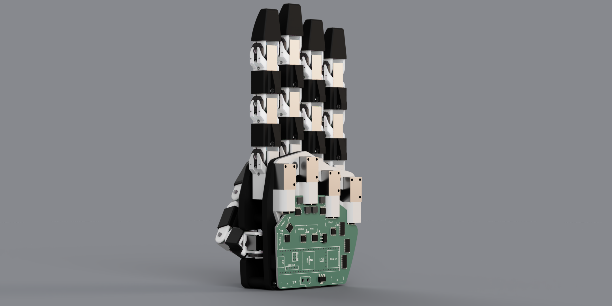
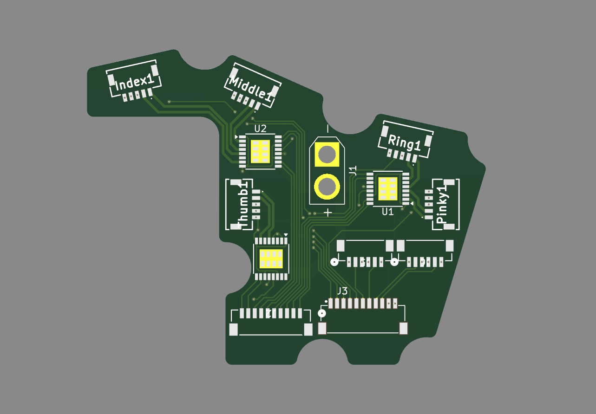
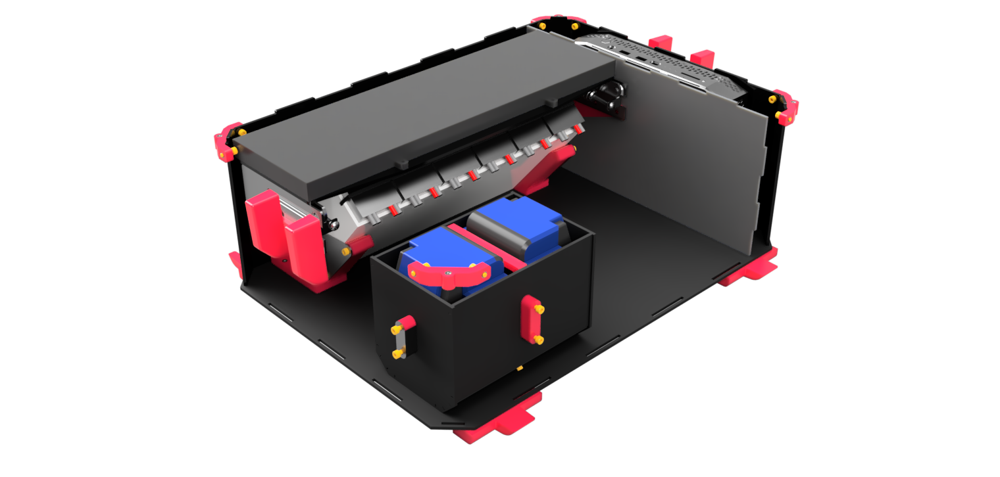
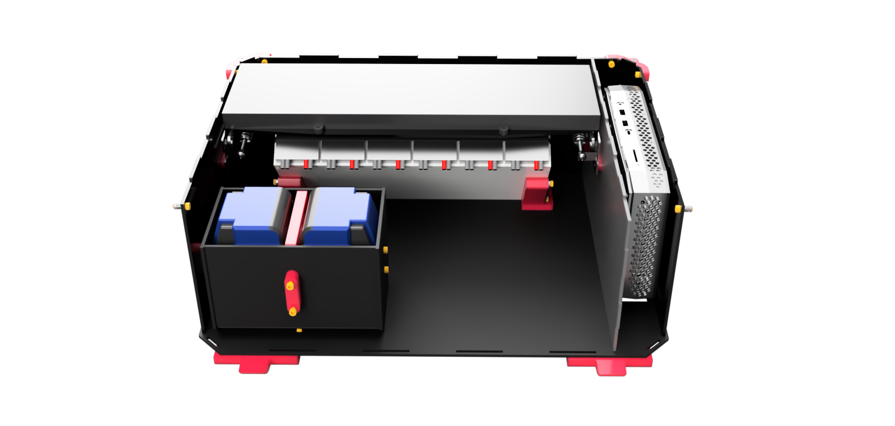
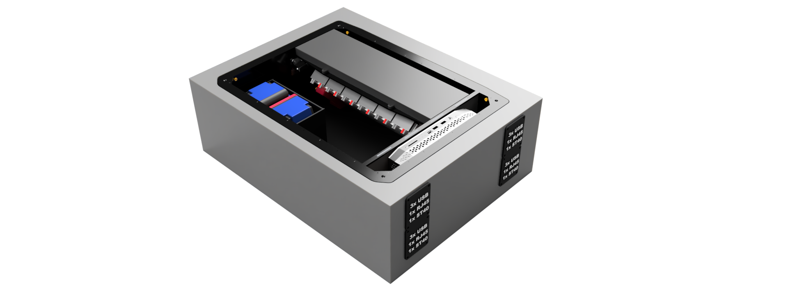

  

    

      

        <video class="card-img" autoplay muted loop playsinline poster="/assets/img/hand_clean.png">
          <source src="/assets/video/hand_demo.mp4" type="video/mp4">
        </video>
        

          
          
        

      

    

    

      
RoboTouch Lab

      <h3 class="card-title">Dexterous Hand</h3>
      
Designed a human-scale dexterous robotic hand with direct-drive worm gear joints to replicate human grasp capabilities.

      <ul class="card-desc">
      <li>Designed modular worm-gear joint drives, favoring grip strength and non-backdrivable holding over speed</li>
      <li>Built the custom palm-mounted PCB, firmware, and joint controllers; transferred RL policies from simulation to the hand</li>
      <li>Modeled kinematics in simulation and built a test framework for joint accuracy, grasp force, and repeatability</li>
      <li>Research paper in preparation on joint design and performance evaluation</li>
      </ul>
      

        Robotics
        PCB Design
        Simulation
      

    

    

  

  

    

      

        
        

          
          
        

      

    

    

      
CERL Lab

      <h3 class="card-title">Electronics Box</h3>
      
Designed a centralized electronics housing to integrate and coordinate multiple modules for a heavy-lift system.

      <ul class="card-desc">
        <li>Custom PCBs, cabling, and waterproof housing designed for field deployment</li>
        <li>External plug panels for clean, accessible module connections</li>
        <li>Adjustable belt tensioning module adaptable across applications</li>
        <li>Component diagrams documenting internal and external system connections</li>
      </ul>
      

        SolidWorks
        Electronics Planning
        Modularity
      

    

    

  

